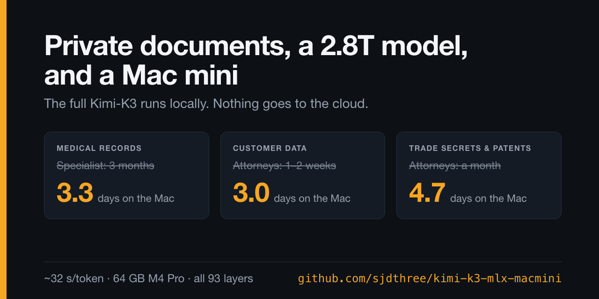

# Kimi-K3 on Apple Silicon / MLX

[](https://github.com/sjdthree/kimi-k3-mlx-macmini/actions/workflows/tests.yml)

[](demos/private-document-analysis/README.md)

**A 2.8-trillion-parameter model on a 64 GB Mac. Slow enough to take days. Useful enough
that days might be fast.**

> *"RAM is expensive! But my SSD can hold a 1.5 TB model — can't I run it off that?"*
>
> **Yes!**

This repository runs the **complete Kimi-K3 checkpoint** (2.8 trillion parameters,
~1.42 TiB of MXFP4 weights, all **93 text-model layers**, no pruned experts) locally on a
**64 GB M4 Pro Mac mini**. The mixture-of-experts weights stream from an external SSD,
expert by expert, and run natively in MLX and Metal on Apple Silicon.

The best measured configuration decoded at **~32.4 seconds/token** with **~15 GiB peak MLX
allocator memory**. That memory number is the MLX high-water mark, not total application
footprint or system memory, and it excludes the OS file cache; the long-context demo runs
below peaked at 22–24 GiB during prefill.

**That's seconds per token, not tokens per second.** Yes, it's slow. What did you expect?

For interactive chat, 32 seconds per token is impractical. But some confidential work
already waits days, weeks or months for a specialist, an attorney or patent counsel. For
that work the useful measure may be **time to useful analysis**, not tokens per second.
[Three applications](#why-run-it-locally-three-applications) below, each tested end to
end on the Mac mini with a synthetic case.

This project was **inspired by and extends [AirLLM](https://github.com/lyogavin/airllm)
and Gavin Li’s Kimi-K3 streaming work**, described in his article
[*Unbelievable! Run Kimi K3–2.8 Trillion Parameters — on a Single 4GB GPU*](https://aiadvances.org/unbelievable-run-kimi-k3-2-8-trillion-parameters-on-a-single-4gb-gpu-23590e7a16c2).
SSD, layer, and expert streaming are prior work; see also
[flash-moe](https://github.com/danveloper/flash-moe), which streams a large MoE model from
SSD on a MacBook. The contributions here are the Apple Silicon implementation, K3 architecture
port, fused Metal MXFP4 kernel, latent MLA cache implementation, and measurement and
validation tooling. [Attribution and licenses](docs/licensing.md).

The full upstream MXFP4 checkpoint is used, without pruning experts or reducing
language-model depth. “Complete” describes the checkpoint and text model; the included
vision tower is **not executed**. The CUDA/FlashAttention/Triton paths in the reference
implementation do not run on Metal, so the text architecture is implemented with MLX
operations and a Metal kernel instead.

## Why run it locally? Three applications

Each application below starts with the situation that motivates it. Each was then
tested with a two-page synthetic "confidential" package that hides a planted conclusion
across several sections, among deliberate distractors. No real patient, client or
company data is involved. The synthetic case is the closest test of the skill each
application needs; it is not a test of that exact workflow.

### 1. Medical records and incidents

> I need a highly specialized doctor, and I don't want years of private test results in
> the open cloud.
> See a specialist? **Best I can do is three months!**
> In the meantime, my Mac can read my complete history (labs, medications, reports,
> notes) locally. A report takes about three days.
>
> **I'll take the 3 days.**

The intended output is an organized briefing for the appointment: a chronology, possible
inconsistencies, and questions to raise with the physician. It is **not a diagnosis**, it
does not replace the doctor, and it cannot tell anyone whether waiting is safe. Urgent
symptoms need prompt professional care.

*What was tested:* an adverse-event investigation at a hospital using a clinical AI
system, with synthetic patient data. The local run found the planted cause, a **stale
machine-readable clinical-policy configuration rather than a model or coding defect**, and
separated model, software, policy, change-control and human contributions. It took 3.3 days.
Material like this is often handled under peer-review or legal protections, which is
part of why an organization may not want it on an outside service.
[Medical-AI case](demos/private-document-analysis/README.md#what-the-model-found)

### 2. Confidential client and customer documents

> I have highly confidential documents and client data. A leak would be the end. My
> attorneys can get back to me in a week or two.
> In the meantime, my Mac can analyze the whole corpus locally in about three days.
>
> **I'll take the 3 days.**

The intended output is preparation for counsel: contract issues, contradictions,
timelines, missing information and questions to ask. Whether sharing a document with an
outside AI service affects privilege or confidentiality depends on the facts, the terms
of the service and the jurisdiction; that is a question for counsel. Local inference
avoids sending the corpus to an external inference provider. It does not by itself meet
any other security, contractual or legal obligation.

*What was tested:* a semiconductor fab excursion, the kind of record a company keeps
quiet because it shows how its chips are made and which customers are affected before
anything has been disclosed. The local run traced the planted chain (chamber maintenance,
a **mis-seated edge gas-ring seal**, edge thinning, bridge defects) and set aside the
distractors. It took 3.0 days. Neither the local nor the cloud run noticed that the
package contradicts itself about one wafer's chamber.
[Semiconductor case](demos/private-document-analysis/README.md#what-the-model-found)

### 3. R&D and trade-secret invention strategy

> I have trade secrets, patents, unfiled inventions and competitor patents. I need a deep
> dive on keep-it-secret versus patent-it. Patent counsel needs a month for all this.
>
> **I'll take the 5 days.**

Engineering knowledge is spread across experiments, manufacturing procedures, firmware,
control algorithms and existing patents. A trade secret stays protected only while the
company takes reasonable steps to keep it secret, and careless disclosure can also damage
a patent strategy. A local model can spend days on the whole corpus and come back with
candidate inventions, technical combinations, likely trade secrets, disclosure risks and
questions for counsel.

*What was tested:* a board-level package about liquid-cooled AI compute modules. The
local run took 4.7 days and:

- found **all four planted concepts** that the existing patent claims do not cover;
- argued that a **combination of three of them** is more defensible than any one, citing
  the >12% pre-charge sensitivity as evidence of synergy;
- flagged a **supplier-side leak path**: statistical aggregation of the machining
  coordinates the supplier receives;
- proposed its own additions, such as a "virtual sensor" built on already-claimed
  pressure sensors, labeling one of them an untested hypothesis.

The cloud reference run also found all four and the combination argument. It proposed a
different extra concept, a self-diagnostic use of the compressibility estimator to detect
pre-charge drift. These are **candidate** inventions, not established patentability; each
would still need a prior-art search and legal review.
[R&D case](demos/private-document-analysis/README.md#what-the-model-found)

### Results

| Application | Synthetic case: what the model was asked | Planted conclusion recovered (local / cloud) | Local run on the Mac mini | Cloud reference | Outputs |
|---|---|---|---|---|---|
| Medical | Medical-AI adverse event: reconstruct it and separate model, software, policy, change-control and human causes | Yes / Yes | 79.9 h (3.3 days), 8,225 tokens | 72 s, $0.106 | [local](runs/demo-local/medical_ai/answer.md) · [cloud](demos/private-document-analysis/cloud-reference/results.md) · [package](demos/private-document-analysis/cases/02_medical_ai_confidential_incident.pdf) |
| Client / customer data | Semiconductor excursion: find the physical mechanism, rank alternatives, propose tests | Yes / Yes | 72.6 h (3.0 days), 7,623 tokens | 187 s, $0.069 | [local](runs/demo-local/semiconductor/answer.md) · [cloud](demos/private-document-analysis/cloud-reference/results.md) · [package](demos/private-document-analysis/cases/01_semiconductor_confidential_excursion.pdf) |
| R&D / trade secret | Find unclaimed inventions and weigh patent versus trade secret | Yes, all four / Yes, all four | 112.5 h (4.7 days), 11,651 tokens | 99 s, $0.151 | [local](runs/demo-local/rd_tradesecret/answer.md) · [cloud](demos/private-document-analysis/cloud-reference/results.md) · [package](demos/private-document-analysis/cases/03_rd_tradesecret_invention_strategy.pdf) |

- **Local** means every token was generated on the Mac mini by this repository, at 34–35
  s/token median. Local times are generation time; the semiconductor run also lost 70
  hours to a USB enclosure dropout, which is excluded.
- **Cloud reference** is the same model through OpenRouter (2026-09-22), run first because
  the documents are synthetic. It is not a local result.
- **Recovered** is one reviewer's reading against the planted conclusions described in
  the [demo README](demos/private-document-analysis/README.md#what-the-model-found). The
  local answers were not scored, and the private evaluator guide holding the answer key
  is not published. Each run is a single sample per case.

[All local answers](demos/private-document-analysis/local-results/results.md) ·
[side-by-side comparison](demos/private-document-analysis/README.md#what-the-model-found) ·
[methodology](demos/private-document-analysis/evaluation/methodology.md)

## When is three days faster than three months?

Cloud inference is fast and cheap: the reference run of all three cases took about six
minutes and cost about **$0.327**. Local inference on this Mac took 3–5 days per case.
If the documents can go to the cloud, use the cloud.

The local case is for material that an organization or a person would rather not send
to a cloud inference provider: medical histories, confidential client files, unpublished
R&D, trade secrets. Then the comparison is not local tokens per second against cloud
tokens per second. It is time to a useful analysis against the time the existing
professional workflow takes: a three-month wait for a specialist, two weeks for
attorneys, a month for patent counsel.

Local inference is not automatically secure or compliant. It removes one party, the
inference provider, from the data flow. The machine, its disks, its backups and the people
with access to it still matter. And these results do not show that a 2.8T model is
necessary: no smaller models were run on the same cases, and that is the obvious next
experiment.

## The machine

| | |
|---|---|
| Computer | Mac mini (Mac16,11), Apple M4 Pro: 14-core CPU (10 performance + 4 efficiency), 20-core GPU |
| Memory | 64 GiB unified memory |
| Checkpoint storage | 2 TB USB4 NVMe enclosure on a **rear** Thunderbolt port. Measured 3.88 GB/s sequential and 3.38 GB/s random (5.25 MiB reads). A front USB-C port managed 1.06 GB/s. |
| Dense-weight cache | 106 GiB, staged on the internal SSD (optional) |
| Software (2026-09-21 validation) | macOS 26.6.2, Python 3.12, MLX 0.29.3 |

Everything else about the run is in [runs/release-validation-2026-09-21](runs/release-validation-2026-09-21/RESULTS.md).

## Sample output

[`runs/final-validation/output.txt`](runs/final-validation/output.txt) is a real
1,383-token answer to a multi-domain audit prompt
([prompt](prompts/04_polymath_multi_expert.md)). It was generated through the local server
in about 13.7 hours of wall time, including a 544-second prefill. The per-token log is
next to it.

## Evidence and limits

| Result | What the repository supports |
|---|---|
| ~32.4 s/token | 39 decode records at 8 GiB dense residency; excludes prefill |
| ~15 GiB memory | MLX allocator high-water mark, not RSS or system memory |
| 53.3× smaller MLA cache | Logical fp32 payload: 2,949,120 → 55,296 bytes/context token across 24 MLA layers; excludes KDA state and capacity slack |
| ~2.35× historical improvement | Whole-run seconds/output-token, including prefill; different output lengths and resident budgets, not an isolated cache-only A/B |
| 0.99999976 worst-layer cosine | Full-depth fp32 run against the derived PyTorch/CPU oracle, rerun at the release commit on 2026-09-21; one generated token, 92/92 routers matched (historical run: 0.99999988) |
| 9.5× fused kernel microbenchmark | One MXFP4 projection benchmark; not an end-to-end speedup |

The [evidence ledger](docs/evidence.md) defines sample selection, configuration,
units, numerical scope, and corrections to older reports. Raw logs remain intact.
Full-checkpoint parity, the smoke test and the numerical-mode tests were rerun at the
release commit on 2026-09-21 and passed. The smoke test's decode time and bytes read per
token matched the historical 8 GiB runs. The timing, memory and speedup figures are still
**historical results** from the earlier sweep and runs. They are not performance
promises for the current checkout. No CUDA end-to-end comparison or million-token-context test is claimed.

## What we tried

Most of the work was finding out what the disk, the OS and the memory system actually do.
These are development measurements from the [historical records](archive/README.md), not
controlled experiments.

**Kept**

- **A local USB4 NVMe drive on a rear port.** Every decode token reads roughly 120 GiB of
  logical data, so storage bandwidth sets the speed.
- **`read()` into buffers, not `mmap`.** On cold data, `np.memmap` measured 389 MB/s
  against 3,551 MB/s for `read()`, because page faults defeat readahead.
- **A small pinned working set (8 GiB).** Of the 8, 16, 24, 32 and 40 GiB budgets
  tested, 8 GiB was fastest (32.4 s/token) and 40 GiB was slowest (69.2 s/token). A
  plausible reason is that pinned memory competes with the OS file cache; this was not
  proven.
- **A fused Metal MXFP4 kernel** that decodes 4-bit weights inside the matrix-vector
  product, without materializing a dequantized expert.
- **A latent MLA cache**, which stores 53× less per context token than the expanded form.

**Discarded**

- **Streaming from a NAS over SMB:** 36–48 MB/s random reads, and concurrency didn't help.
- **The Mac mini's front USB-C port:** it silently falls back to 10 Gbps USB, about 3.6×
  slower.
- **An LRU weight cache:** a 24 GiB cache had a 0% hit rate, because each token scans the
  layers in order and evicts exactly what it needs next.
- **A larger pinned budget:** see above.

## Try it without the checkpoint

On an Apple Silicon Mac with GPU access, macOS 15+, and Python 3.11 or 3.12:

```sh
python3.12 -m venv .venv
source .venv/bin/activate
python -m pip install -c constraints-test.txt -e '.[dev]'
python tests/test_synthetic_integration.py
python tests/run_all.py
```

The synthetic test creates a tiny random checkpoint and compares eager, streaming,
fused/unfused, and saved-state paths. It tests execution, **not language quality**.
It typically takes seconds to minutes. Real-checkpoint tests print `SKIP` when the
checkpoint is absent; skipped tests are not evidence that the full model passed.

For real inference, follow [INSTALL.md](INSTALL.md) for checkpoint acquisition,
storage, manifest verification, dense staging, and the first full-depth smoke test.
[QUICKSTART.md](QUICKSTART.md) provides the shortest command sequence.

## Implementation

- Native MLX text architecture: MLA, KDA recurrence, attention residuals, latent MoE,
  shared experts, and top-16 routing over 896 experts in each MoE layer.
- Bounded per-expert weight loading; optional fill-and-pin dense residency. The best
  recorded budget on the 64 GiB machine was 8 GiB, not the largest budget tested.
- Fused Metal MXFP4 projection without materializing a full dequantized expert matrix.
- Latent MLA KV storage and chunked capacity growth. This implements the architecture’s
  latent-attention algebra; it does not invent MLA or guarantee bitwise identity.
- CLI and a local server implementing a documented subset of the Chat Completions
  API, including streaming. [API limitations](docs/API.md).

## How this was built

This is a one-person project written with heavy use of an AI coding assistant (Claude,
via Claude Code); commits co-authored with it are marked in the history. The numbers
come from logged runs on the machine above, and the logs are committed so that they can
be checked.

## Reproduce, contribute, release

[Tests and contribution guide](CONTRIBUTING.md) ·
[Measurement definitions](docs/evidence.md) ·
[Historical records](archive/README.md) ·
[Security reporting](SECURITY.md) ·
[Release checklist](docs/release.md)

First-party work is MIT where indicated. Moonshot-derived reference/configuration
material and the copied tokenizer pattern are separately covered by the **Kimi K3
License**; the vendored FLA reference kernel is MIT with its upstream notice. The
model weights are separately licensed and are not distributed here. Read
[NOTICE](NOTICE) and [the provenance inventory](docs/licensing.md); the distribution
must not be represented as uniformly MIT.

The Kimi K3 License is permissive, but its sections 2 and 3 add conditions for large
commercial deployments. A model-as-a-service business with more than US$20 million
revenue over 12 months needs a separate agreement with Moonshot AI. A product with more
than 100 million monthly active users or US$20 million monthly revenue must display
"Kimi K3" prominently. Read [the license](licenses/LICENSE.kimi-k3) before commercial use.
This summary is not legal advice.
